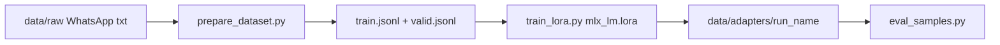

# Training plan — LoRA / QLoRA (no app changes)

## Constraint

Do not modify `src/personal_reply/`, app `scripts/`, `tests/`, or app configs. RAG + Ollama remain the production path. All fine-tune work stays under `training/`.

## Pipeline

## Steps

1. **Dataset** — Parse WhatsApp `.txt` exports; for each of your sent messages emit a chat example `(system, user=context, assistant=reply)`; filter media/empty; 90/10 train/valid split → `data/processed/`.
2. **Train** — Load base (or 4-bit base for QLoRA); attach LoRA; train with mlx-lm; write adapter + `run_metadata.json` + generated `mlx_lora_config.yaml`.
3. **Eval** — Sample `valid.jsonl`; generate with base+adapter; print context / gold / model; report length stats.

## Defaults

| Setting | Value |
|---------|--------|
| Base | `mlx-community/Qwen2.5-0.5B-Instruct-bf16` |
| QLoRA base | `mlx-community/Qwen2.5-0.5B-Instruct-4bit` when `use_qlora = true` |
| LoRA | rank 16, scale 20, dropout 0.05, 16 layers |
| Train | 600 iters, batch 1, lr 1e-5, mask_prompt |
| Output | `training/data/adapters/whatsapp-style/` |

## Non-goals

- No wiring into menubar / `reply/generate.py`
- No LanceDB / embeddings
- No Gmail mbox training yet (same JSONL shape later)
